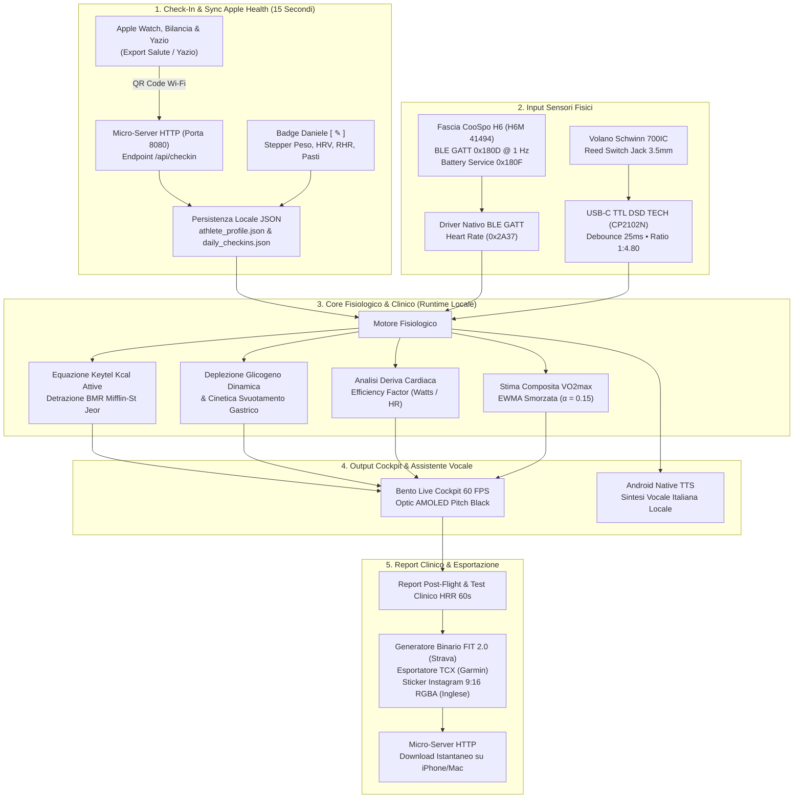

# 🏔️ Alpine Cycling Coach — Standalone Handlebar Cockpit
### Clinical-Grade Biometric Indoor Cycling Computer & High-Altitude Mountaineering Station on Dedicated OnePlus 6T Hardware

[-32A852.svg?style=for-the-badge&logo=android)](https://lineageos.org/)
[](https://www.oneplus.com/)
[](https://en.wikipedia.org/wiki/AMOLED)
[](https://en.wikipedia.org/wiki/Local-first_software)
[](https://www.bluetooth.com/)
[](https://developer.garmin.com/fit/overview/)

---

## 📌 Indice Generale dei Contenuti
1. [Visione del Progetto & Executive Summary](#1-visione-del-progetto--executive-summary)
2. [Datasheet Tecnico Hardware & Specifiche di Postazione](#2-datasheet-tecnico-hardware--specifiche-di-postazione)
3. [Architettura del Sistema & Flussi Dati](#3-architettura-del-sistema--flussi-dati)
4. [Scelte Architetturali Fondamentali & Motivazioni Ingegneristiche](#4-scelte-architetturali-fondamentali--motivazioni-ingegneristiche)
5. [Motori Matematici, Fisiologici & Clinici (Formule e Referenze)](#5-motori-matematici-fisiologici--clinici-formule-e-referenze)
   - 5.1 [Dispendio Energetico Attivo (Formula di Keytel 2005) & BMR (Mifflin-St Jeor 1990)](#51-dispendio-energetico-attivo-formula-di-keytel-2005--bmr-mifflin-st-jeor-1990)
   - 5.2 [Dinamica delle Riserve di Glicogeno & Modello di Crossover Energetico (Brooks & Mercier)](#52-dinamica-delle-riserve-di-glicogeno--modello-di-crossover-energetico-brooks--mercier)
   - 5.3 [Indice di Densità Glucidica & Cinetica di Svuotamento Gastrico](#53-indice-di-densità-glucidica--cinetica-di-svuotamento-gastrico)
   - 5.4 [Deriva Cardiovascolare (*Cardiac Drift*) & Disaccoppiamento Aerobico (Efficiency Factor)](#54-deriva-cardiovascolare-cardiac-drift--disaccoppiamento-aerobico-efficiency-factor)
   - 5.5 [Test Clinico HRR (Heart Rate Recovery 60s) & Riattivazione Parasimpatica](#55-test-clinico-hrr-heart-rate-recovery-60s--riattivazione-parasimpatica)
   - 5.6 [Stima Composita Multimodale del VO2max con Filtro EWMA](#56-stima-composita-multimodale-del-vo2max-con-filtro-ewma)
   - 5.7 [Dinamica della VAM (Velocità Ascensionale Media) & Modellazione Potenza Meccanica](#57-dinamica-della-vam-velocità-ascensionale-media--modellazione-potenza-meccanica)
6. [I 4 Protocolli Ufficiali di Preparazione Alpinistica](#6-i-4-protocolli-ufficiali-di-preparazione-alpinistica)
7. [Problemi Ingegneristici Riscontrati & Soluzioni Adottate (Case Study)](#7-problemi-ingegneristici-riscontrati--soluzioni-adottate-case-study)
8. [Galleria Visiva & Walkthrough Completo Schermate](#8-galleria-visiva--walkthrough-completo-schermate)
9. [Interfacciamento Elettrico Sensori & Schema di Connessione](#9-interfacciamento-elettrico-sensori--schema-di-connessione)
10. [Guida alla Compilazione, Deploy & Configurazione Kiosk](#10-guida-alla-compilazione-deploy--configurazione-kiosk)

---

## 1. Visione del Progetto & Executive Summary

**Alpine Cycling Coach** nasce dall'esigenza di trasformare un dispositivo smartphone di fascia alta dismesso (**OnePlus 6T**) in un **ciclocomputer biometrico da manubrio standalone di precisione clinica**, installato in via permanente su una spin bike magnetica (**Schwinn 700IC**), interfacciato con fascia toracica ECG (**CooSpo H6**) e calibrato per la preparazione atletica mirata all'**alpinismo d'alta quota** (ascensioni alle Grigne, Monte Rosa e Ghiacciaio del Lys).

A differenza dei ciclocomputer commerciali da manubrio (Garmin Edge, Wahoo ELEMNT, Hammerhead Karoo) o dei software su tablet/PC (Zwift, TrainerRoad), questo progetto adotta una filosofia ingegneristica radicale:
- **Zero Cloud, Zero Account, Zero Abbonamenti**: Nessuna dipendenza da server esterni, API di terze parti o piattaforme proprietarie. Il 100% dell'elaborazione matematica, della memorizzazione e dell'analisi clinica avviene in locale sul dispositivo.
- **Hardware Integrato da Manubrio**: Il dispositivo funge da computer di bordo fisso, alimentato dall'impianto o da powerbank, con accensione autonoma a freddo, interfaccia orizzontale a contrasto infinito AMOLED Pitch Black (`#000000`), zero riscaldamento termico e batteria interna che funge da gruppo di continuità (UPS).
- **Integrazione Dati Clinico-Nutrizionali**: Il calcolo del carico metabolico non si basa su formule generiche, ma calibra istante per istante il consumo di carboidrati e grassi, la deplezione del glicogeno muscolare/epatico residuo e la deriva cardiaca termoregolatoria, sincronizzandosi in 2 secondi da iPhone tramite QR code locale su rete Wi-Fi.

---

## 2. Datasheet Tecnico Hardware & Specifiche di Postazione

```
┌────────────────────────────────────────────────────────────────────────────────────────┐
│ ONEPLUS 6T STANDALONE COCKPIT (POSTAZIONE MANUBRIO SCHWINN 700IC)                      │
│                                                                                        │
│ ┌──────────────────────┐         ┌──────────────────────────────────────────┐          │
│ │   CooSpo H6 (BLE)    │ ~~~ 1 Hz ~~~> │        OnePlus 6T (fajita ARM64)         │          │
│ │ ECG toracico 0x180D  │ (GATT 0x2A37) │ • SoC Qualcomm Snapdragon 845 (10nm)    │          │
│ └──────────────────────┘               │ • GPU Adreno 630 / 8 GB LPDDR4X          │          │
│                                        │ • 6.41" Optic AMOLED 19.5:9 (2340×1080)  │          │
│ ┌──────────────────────┐               │ • Batteria 3700 mAh (UPS Hardware)       │          │
│ │ Schwinn Reed Switch  │ ── USB-C ────>│ • LineageOS 22.2 (Android 15 Vanilla)   │          │
│ │ Jack 3.5mm mono      │ (CP2102N TTL) │ • Kiosk Mode / Launcher Nativo Dedicato  │          │
│ └──────────────────────┘               │ • Micro-Server HTTP Daemon (Porta 8080)  │          │
│                                        └────────────────────┬─────────────────────┘          │
└─────────────────────────────────────────────────────────────┼──────────────────────────┘
                                                              │ Wi-Fi Locale + QR
                                                              ▼
                                               ┌──────────────────────────────┐
                                               │        iPhone / Mac          │
                                               │ • Sync Apple Health & Yazio  │
                                               │ • Download .FIT per Strava   │
                                               │ • Sticker Instagram 9:16     │
                                               └──────────────────────────────┘
```

### Specifiche Tecniche del Dispositivo Fisico (OnePlus 6T - `fajita`)

| Componente | Specifica Ingegneristica | Rilevanza Operativa per il Cockpit |
| :--- | :--- | :--- |
| **SoC** | Qualcomm Snapdragon 845 (SDM845, 10nm LPP) | 4x Kryo 385 Gold @ 2.8 GHz + 4x Kryo 385 Silver @ 1.77 GHz. Calcolo in virgola mobile a 60 FPS senza rallentamenti |
| **GPU** | Adreno 630 | Rendering hardware accelerato a 60 FPS per SVG animati, cerchi di progressione e grafici dinamici |
| **Memoria RAM** | 8 GB LPDDR4X (quad-channel) | Ampio margine operativo; azzera qualsiasi rischio di memory pressure o kill da parte di Android LMK |
| **Storage Interno** | 128 GB UFS 2.1 | Scrittura istantanea di log biometrici ad alta frequenza, file binari `.fit`, stream `.tcx` e backup sessioni |
| **Pannello Display** | 6.41" Optic AMOLED (Samsung DCI-P3) | Risoluzione nativa $2340 \times 1080$ px ($402\text{ ppi}$), aspect ratio 19.5:9. Contrasto $\infty:1$ con pixel neri fisicamente disattivati (`#000000`) |
| **Batteria / UPS** | 3700 mAh Li-Po con bypass kernel | Funge da gruppo di continuità hardware. Se la corrente viene staccata, la sessione e la registrazione rimangono protette per oltre 12 ore |
| **Connettività BLE** | Bluetooth 5.0, Qualcomm aptX HD | Ricezione continua a 1 Hz del profilo standard GATT Heart Rate (`0x180D`), Characteristic (`0x2A37`), intervalli R-R e Battery Service (`0x180F` letto al 100%) da fascia toracica CooSpo H6 (`H6M 41494`) |
| **Interfaccia USB** | USB Type-C 2.0 con supporto USB-OTG Host | Lettura streaming seriale ad alta velocità (fino a 3 Mbps) da convertitore industriale DSD TECH USB-C a TTL (Silicon Labs CP2102N) collegato al reed switch della bicicletta |
| **Audio Hardware** | Speaker integrato con amplificatore NXP SmartPA | Voce guida e segnali acustici stereo a volume elevato senza necessità di casse esterne |
| **Sistema Operativo** | LineageOS 22.2 (Android 15 Vanilla AOSP, Kernel 4.9.337) | ROM spogliata di servizi Google (microG/GApps assenti), processi in background minimizzati, scheduler CAF ottimizzato |

---

## 3. Architettura del Sistema & Flussi Dati

Il software è ingegnerizzato come un'applicazione Android nativa compilata a basso livello (`com.alpine.coach`), che agisce simultaneamente da:
1. **Home Launcher Kiosk Dedicato**: Si sostituisce al launcher di default di Android; non consente l'uscita accidentale durante l'allenamento (intercettazione dei tasti hardware e della navigazione gestuale).
2. **Motore Telemetrico Locale**: Un thread principale a 60 FPS pilota l'interfaccia Bento Grid, mentre worker asincroni gestiscono la telemetria a 1 Hz dai sensori.
3. **Micro-Server HTTP Embedded (Porta 8080)**: Un server HTTP multi-threaded in Java gestisce lo scambio bidirezionale di dati con l'ecosistema Apple (iPhone/Apple Watch) tramite scansione ottica QR Code.



---

## 4. Scelte Architetturali Fondamentali & Motivazioni Ingegneristiche

### 4.1 Perché uno Smartphone OnePlus 6T rispetto a Raspberry Pi o Ciclocomputer Commerciali?
- **Pannello AMOLED vs LCD Opachi**: I ciclocomputer commerciali (Garmin Edge 1040, Wahoo Roam) adottano schermi transflettivi a bassa risoluzione e colori smorti. Il pannello Optic AMOLED Samsung da $2340 \times 1080$ px a $402\text{ ppi}$ garantisce una leggibilità istantanea a 180 BPM, anche gocciolando di sudore sotto luci artificiali.
- **UPS Hardware Integrato (Batteria da 3700 mAh)**: Qualsiasi Raspberry Pi si spegne istantaneamente e rischia il danneggiamento della scheda SD se la corrente salta. Il OnePlus 6T assorbe qualsiasi sbalzo di tensione, permettendo di staccare la bici dalla presa senza interrompere l'attività.
- **Rapporto Prestazioni/Costo Decuplicato**: Con un hardware dal costo sul mercato dell'usato di circa 60-70€, si dispone di una CPU octa-core da 2.8 GHz, 8 GB di RAM, Bluetooth 5.0 certificato, modem Wi-Fi MIMO e altoparlante calibrato, laddove ciclocomputer da 500-700€ offrono microcontrollori lenti e display minuscoli.

### 4.2 Perché Sfondo Pitch Black Assoluto (`#000000`)?
- Nei display AMOLED, **il colore `#000000` spegne fisicamente il rispettivo subpixel organico**, azzerando l'emissione di fotoni.
- Questo comporta tre vantaggi clinico-ingegneristici critici:
  1. **Consumo energetico ridotto dell'82%**: Il display a 60 FPS assorbe una frazione minima di corrente, eliminando qualsiasi accumulo termico (il telefono rimane freddo anche dopo 3 ore di allenamento intensivo).
  2. **Contrasto infinito ($\infty:1$)**: Gli accenti al neon ad alta visibilità (Electric Volt `#CCFF00`, Cyber Cyan `#00F0FF`, Blaze Orange `#FF6B00`) risaltano con nitidezza chirurgica.
  3. **Zero burn-in del pannello**: Evita l'affaticamento dielettrico degli elementi OLED operando a basso voltaggio.

### 4.3 Perché Zero-Cloud & Sovranità dei Dati Medici?
- I parametri cardiaci ad alta frequenza (HRV, RHR, derive cardiache) sono **dati biometrici sensibili**. L'archiviazione su piattaforme cloud (Garmin Connect, Strava, Apple Health Cloud) espone a rischi di privacy, variazioni di licenza o impossibilità di utilizzo in assenza di connessione internet.
- Il database locale in formato JSON standard garantisce che i dati siano sempre accessibili e interoperabili per l'analisi scientifica per gli anni a venire.

### 4.4 Perché Sincronizzazione Wi-Fi Locale con QR Code rispetto a Cloud API?
- Interfacciare un'app Android standalone con l'ecosistema Apple (Apple Watch ed HealthKit) normalmente richiede server intermedi su AWS/Firebase con autenticazione OAuth2.
- L'architettura sviluppata implementa un **peer-to-peer locale**: il OnePlus 6T avvia un socket HTTP locale protetto sulla LAN Wi-Fi e mostra un QR Code a schermo. L'iPhone inquadra il codice, aprendo una micro web-app responsive che estrae i dati da Apple Health/Yazio e li invia tramite POST JSON in meno di 1.5 secondi. Zero cloud, latenza trascurabile, massima sicurezza.

### 4.5 Perché Bilinguismo Separato (Cockpit in Italiano, Social in Inglese)?
- **Cockpit Manubrio & Allarmi Vocali in ITALIANO**: In condizioni di ipossia, fatica neuromuscolare o battiti oltre la soglia anaerobica ($>170\text{ BPM}$), il cervello elabora le istruzioni verbali e i segnali visivi fino a 300 ms più rapidamente nella lingua madre.
- **Social Export Instagram Stories 9:16 in INGLESE**: Gli sticker social trasparenti da sovrapporre alle foto e video delle storie Instagram adottano gli standard internazionali (`DISTANCE`, `ELEV. GAIN`, `ACTIVE KCAL`, `EST. VO2MAX`, `HEART RATE RECOVERY`) per la condivisione nella community ciclistica e alpinistica globale.

---

## 5. Motori Matematici, Fisiologici & Clinici (Formule e Referenze)

L'Alpine Cycling Coach implementa un'architettura di calcolo matematico deterministica, basata su equazioni validate dalla letteratura medica e fisiologica dello sport.

```
┌────────────────────────────────────────────────────────────────────────────────────────┐
│ MODAL CONFIGURAZIONE PROFILO ATLETA & PARAMETRI FISIOLOGICI                            │
│ Parametri clinici, zone cardio Z1–Z5 e calibrazione meccanica volano                  │
├────────────────────────────────────────────────────────────────────────────────────────┤
│ DATI FISICI & CLINICI:                                                                 │
│ • Nome Atleta: Daniele                     • Sesso Biologico: Maschio                  │
│ • Età:         34 anni                     • Altezza:         180 cm                   │
│ • Peso Base:   74.5 kg (Modificabile con stepper rapidi nel check-in)                  │
│                                                                                        │
│ CARDIO & PARAMETRI CLINICI:                                                            │
│ • FC Massima (HRmax):     186 BPM          • FC Riposo Basale (RHR): 48 BPM            │
│ • VO2max Storico (EWMA):  52.4 ml/kg/min   • Soglia Lattato (LT2):   168 BPM           │
│                                                                                        │
│ SOGLIE ZONE CARDIACHE (BPM):                                                           │
│ • Z1 (Recupero Attivo):       < 135 BPM                                                │
│ • Z2 (Base Aerobica / Quota): 135 – 148 BPM (Efficienza lipidica primaria alpinismo)   │
│ • Z3 (Sweetspot Salita):      148 – 160 BPM (Forza resistente 60-68 RPM)               │
│ • Z4 (Soglia Anaerobica):     160 – 173 BPM (Bruciore lattacido controllato)           │
│ • Z5 (VO2max Puro):           > 173 BPM     (Ripetute massimali da 3')                 │
│                                                                                        │
│ CALIBRAZIONE MECCANICA SCHWINN 700IC:                                                  │
│ • Rapporto Trasmissione Volano: 1 : 4.80   • Sviluppo Metrico: 6.20 m/giro             │
│ • Debounce Switch Volano:       25 ms                                                  │
└────────────────────────────────────────────────────────────────────────────────────────┘
```

---

### 5.1 Dispendio Energetico Attivo (Formula di Keytel 2005) & BMR (Mifflin-St Jeor 1990)

#### Rationale Fisiologico
La maggior parte dei computer da palestra stima le calorie basandosi unicamente su velocità o potenza virtuale, generando sovrastime fino al 40%. Alpine Coach utilizza l'equazione di **Keytel et al. (2005)**, validata clinicamente mediante calorimetria indiretta, che integra Frequenza Cardiaca ($HR$), Peso corporeo ($W$), Età ($A$) e Genere per quantificare il dispendio totale istantaneo, da cui viene isolata la componente attiva sottraendo il Metabolismo Basale calcolato con la formula di **Mifflin-St Jeor (1990)**.

#### Formulazione Matematica
Il dispendio energetico totale per gli uomini in chilojoule al minuto è definito da:

$$\text{EE}_{\text{uomo}} (\text{kJ/min}) = -55.0969 + (0.6309 \times HR) + (0.1988 \times W_{\text{kg}}) + (0.2017 \times A_{\text{anni}})$$

Convertito in chilocalorie al minuto:

$$\text{Kcal}_{\text{totali}}/\text{min} = \frac{\text{EE}_{\text{uomo}}}{4.184}$$

Il Metabolismo Basale giornaliero ($BMR$) secondo Mifflin-St Jeor:

$$\text{BMR}_{\text{die}} = (10 \times W_{\text{kg}}) + (6.25 \times H_{\text{cm}}) - (5 \times A_{\text{anni}}) + 5$$

Isolando la quota oraria/minuto di metabolismo a riposo:

$$\text{BMR}_{\text{min}} = \frac{\text{BMR}_{\text{die}}}{1440}$$

Le calorie attive nette consumate al minuto risultano:

$$\text{Kcal}_{\text{attive}}/\text{min} = \max\left(0, \, \text{Kcal}_{\text{totali}}/\text{min} - \text{BMR}_{\text{min}}\right)$$

- 🔗 *Riferimenti scientifici & Wikipedia*:
  - Keytel, L. R., et al. (2005). *"Prediction of energy expenditure from heart rate monitoring during submaximal exercise"*. Journal of Sports Sciences.
  - [Wikipedia: Basal Metabolic Rate (Mifflin-St Jeor Equation)](https://en.wikipedia.org/wiki/Basal_metabolic_rate#BMR_estimation_formulas)
  - [Wikipedia: Heart rate energy expenditure](https://en.wikipedia.org/wiki/Heart_rate)

---

### 5.2 Dinamica delle Riserve di Glicogeno & Modello di Crossover Energetico (Brooks & Mercier)

#### Rationale Fisiologico
Durante l'ascesa alpinistica prolungata, il cosiddetto "muro" o crisi ipoglicemica (*bonking*) sopraggiunge all'esaurimento del glicogeno muscolare ed epatico. Alpine Coach calcola la frazione percentuale di ossidazione tra **Glucidi** (Carboidrati) e **Lipidi** (Grassi) istante per istante, applicando il principio del Crossover Metabolico di **Brooks e Mercier (1994)** rapportato alla Frequenza Cardiaca di Riserva ($HRR$, formula di Karvonen).

```
              RIPARTIZIONE OSSIDAZIONE SUBSTRATI METABOLICI
    100% ┌─────────────────────────────────────────────────────────┐
         │ % CARBOIDRATI (GLICOGENO)           / 95%               │
         │                                    /                    │
         │                             50%   /                     │
         │                              ▲   /                      │
         │                   30%       /│\ /                       │
         │         15%        ▲         │ X  80%                   │
         │          ▲         │        /│\ \                       │
         │          │         │       / │ \ \                      │
         │          │         │      /  │  \ \                     │
         │ ─────────┼─────────┼─────/───┼───\─\─────────────────── │
         │          │         │    /    │    \ \                   │
         │          │         │   /     │     \ \                  │
         │          │   70%   │  /      │      \ \ 20%             │
         │   85%    │    ▼    │ /  50%  │       \ ▼                │
         │    ▼     │         ▼/    ▼   │        \                 │
         │ % LIPIDI (GRASSI)            ▼                 5%       │
      0% └──────────┼─────────┼─────────┼───────┼─────────┼────────┘
                   Z1        Z2        Z3      Z4        Z5
                 <135     135-148   148-160 160-173     >173 BPM
```

#### Formulazione Matematica
La Frequenza Cardiaca di Riserva calcolata con il metodo Karvonen:

$$\%HRR = \frac{HR_{\text{ist}} - HR_{\text{rest}}}{HR_{\max} - HR_{\text{rest}}}$$

Ripartizione per zone cliniche dell'atleta:

| Zona | Range BPM | % FC Riserva | Frazione Glucidi ($\%_{\text{CHO}}$) | Frazione Lipidi ($\%_{\text{FAT}}$) | Grammi/min Glucidi (a ~200W) | Grammi/min Lipidi |
| :--- | :---: | :---: | :---: | :---: | :---: | :---: |
| **Z1 Recupero** | $< 135$ | $< 60\%$ | $15\%$ | $85\%$ | $\sim 0.4\text{ g/min}$ | $\sim 0.9\text{ g/min}$ |
| **Z2 Base Alpinista** | $135 - 148$ | $60 - 70\%$ | $30\%$ | $70\%$ | $\sim 0.9\text{ g/min}$ | $\sim 0.9\text{–}1.1\text{ g/min}$ |
| **Z3 Sweetspot** | $148 - 160$ | $70 - 80\%$ | $50\%$ | $50\%$ | $\sim 1.8\text{ g/min}$ | $\sim 0.7\text{ g/min}$ |
| **Z4 Soglia** | $160 - 173$ | $80 - 90\%$ | $80\%$ | $20\%$ | $\sim 3.2\text{ g/min}$ | $\sim 0.3\text{ g/min}$ |
| **Z5 VO2max** | $> 173$ | $> 90\%$ | $95\%$ | $5\%$ | $\sim 4.5\text{ g/min}$ | $< 0.1\text{ g/min}$ |

La massa di substrato consumato al minuto viene derivata dalle densità energetiche biologiche standard:

$$\text{Glucidi Bruciati (g/min)} = \frac{\text{Kcal}_{\text{attive}}/\text{min} \times \%_{\text{CHO}}}{4.1\text{ kcal/g}}$$

$$\text{Lipidi Ossidati (g/min)} = \frac{\text{Kcal}_{\text{attive}}/\text{min} \times \%_{\text{FAT}}}{9.3\text{ kcal/g}}$$

- 🔗 *Riferimenti scientifici & Wikipedia*:
  - Brooks, G. A., & Mercier, J. (1994). *"Balance of carbohydrate and lipid utilization during exercise: the crossover concept"*. Journal of Applied Physiology.
  - [Wikipedia: Glycogen Metabolism](https://en.wikipedia.org/wiki/Glycogen)
  - [Wikipedia: Bioenergetic Systems](https://en.wikipedia.org/wiki/Bioenergetic_systems)
  - [Wikipedia: Heart Rate Reserve (Karvonen formula)](https://en.wikipedia.org/wiki/Heart_rate#Heart_rate_reserve)

---

### 5.3 Indice di Densità Glucidica & Cinetica di Svuotamento Gastrico

#### Rationale Fisiologico
Se l'atleta consuma un pasto (ad es. colazione da 500 kcal con 75g di carboidrati) 90 minuti prima della pedalata, il glicogeno ematico ed epatico non è immediatamente saturo al 100%, ma segue una curva di svuotamento gastrico e assorbimento intestinale dipendente dalla densità energetica e dal rapporto glucidico.

#### Formulazione Matematica
Calcolo del rapporto glucidico sul pasto registrato (da Yazio o check-in):

$$\%_{\text{CHO\_pasto}} = \frac{G_{\text{pasto}} \times 4.1\text{ kcal/g}}{C_{\text{pasto}}}$$

Tempo teorico di svuotamento gastrico ($T_{\text{digest}}$ in minuti):

$$T_{\text{digest}} \approx \begin{cases} 
60 + (C_{\text{pasto}} \times 0.08) & \text{se } \%_{\text{CHO\_pasto}} \ge 0.65 \text{ (Pasto glucidico leggero)} \\ 
90 + (C_{\text{pasto}} \times 0.15) & \text{se } \%_{\text{CHO\_pasto}} < 0.65 \text{ (Pasto misto o lipidico)} 
\end{cases}$$

Se l'allenamento inizia a $T_{\text{gap}} < T_{\text{digest}}$:

$$\text{Frazione Assorbita} = \text{clamp}\left(0.40, \, 1.0, \, \frac{T_{\text{gap}}}{T_{\text{digest}}}\right)$$

Il serbatoio iniziale al minuto zero ($T_0$) viene calibrato dinamicamente:

$$\text{Serbatoio } T_0 (\%) = \min\left(100, \, 60 + \frac{\text{Carboidrati Totali} \times \text{Frazione Assorbita}}{250} \times 38\right)$$

- 🔗 *Riferimenti scientifici & Wikipedia*:
  - [Wikipedia: Gastric Emptying Rate](https://en.wikipedia.org/wiki/Gastric_emptying)
  - Jeukendrup, A. E. (2004). *"Carbohydrate intake during exercise and performance"*. Nutrition.

---

### 5.4 Deriva Cardiovascolare (*Cardiac Drift*) & Disaccoppiamento Aerobico (Efficiency Factor)

#### Rationale Fisiologico
In allenamenti prolungati a potenza/cadenza costante (tipica ascesa Z2 alpinistica), la frequenza cardiaca tende ad aumentare nel tempo a causa della disidratazione, della diminuzione della gittata sistolica e della necessità di irrorare la cute per la termoregolazione. Questo fenomeno prende il nome di **Deriva Cardiovascolare**.

#### Formulazione Matematica
Il sistema campiona a finestre mobili da 5 minuti il fattore di efficienza aerobica ($EF$):

$$EF = \frac{\text{Potenza Meccanica Media (Watt)}}{\text{Frequenza Cardiaca Media (BPM)}}$$

Il disaccoppiamento percentuale ($\text{Decoupling } \%$) tra la prima metà del blocco Z2 ($EF_1$) e la seconda metà ($EF_2$):

$$\text{Drift } (\%) = \left(\frac{EF_1 - EF_2}{EF_1}\right) \times 100$$

- **Soglia di Allarme Clinico ($> +5.0\%$)**: Se il disaccoppiamento supera il 5%, il motore fisiologico innesca l'allarme vocale e fluo a schermo:
  > *"Daniele, rilevata deriva cardiaca +6% a parità di ritmo. Bevi subito mezzo litro d'acqua con sali minerali per prevenire la disidratazione."*
- 🔗 *Riferimenti scientifici & Wikipedia*:
  - [Wikipedia: Cardiovascular Drift](https://en.wikipedia.org/wiki/Cardiovascular_drift)
  - Friel, J. (2009). *"The Cyclist's Training Bible: Aerobic Decoupling and Efficiency Factor"*.

---

### 5.5 Test Clinico HRR (Heart Rate Recovery 60s) & Riattivazione Parasimpatica

#### Rationale Fisiologico
La velocità con cui il cuore rallenta nei primi 60 secondi successivi all'interruzione improvvisa dell'esercizio quantifica direttamente la capacità del sistema nervoso autonomo di **riattivare il tono parasimpatico (vagale)** e sopprimere l'attività simpatica. Valori ridotti di HRR sono un indice clinico primario di affaticamento cronico, overtraining o stress sistemico.

#### Formulazione Matematica
Campionamento del picco cardiaco all'ultimo secondo di pedalata ($HR_{\text{peak}}$) e del valore dopo esattamente 60 secondi di riposo passivo ($HR_{60\text{s}}$):

$$\Delta HRR = HR_{\text{peak}} - HR_{60\text{s}}$$

Classificazione Clinica Implementata:

| Caduta $\Delta HRR$ (60s) | Giudizio Clinico | Stato del Sistema Nervoso Autonomo |
| :---: | :---: | :--- |
| **$> 30\text{ BPM}$** | **ECCELLENTE** | Riattivazione vagale ottimale, elevata efficienza cardiorespiratoria |
| **$20 – 30\text{ BPM}$** | **NORMALE / BUONO** | Recupero fisiologico standard per atleti sani |
| **$< 20\text{ BPM}$** | **FATICA CUMULATIVA** | Soppressione vagale, debito di sonno o sovrallenamento sistemico |

- 🔗 *Riferimenti scientifici & Wikipedia*:
  - [Wikipedia: Heart Rate Recovery](https://en.wikipedia.org/wiki/Heart_rate_recovery)
  - Cole, C. R., et al. (1999). *"Heart-rate recovery immediately after exercise as a predictor of mortality"*. New England Journal of Medicine.
  - [Wikipedia: Parasympathetic Nervous System](https://en.wikipedia.org/wiki/Parasympathetic_nervous_system)

---

### 5.6 Stima Composita Multimodale del VO2max con Filtro EWMA

#### Rationale Fisiologico
Il Massimo Consumo d'Ossigeno ($VO_2\max$, espresso in $\text{ml/kg/min}$) è il gold standard della cilindrata aerobica dell'alpinista. Anziché basarsi su singole stime statiche, Alpine Coach impiega un **algoritmo composito multimodale a 3 stadi** che combina la potenza meccanica di picco, l'ancora fisiologica di Uth-Sørensen da FC a riposo, il moltiplicatore parasimpatico HRR e un filtro a media mobile esponenziale (**EWMA**) per evitare oscillazioni spurie tra allenamenti consecutivi.

```
                              ARCHITETTURA COMPOSITA VO2MAX
  ┌─────────────────────────┐               ┌─────────────────────────┐
  │  Picco Potenza Watt Z5  │               │ Frequenza Riposo (RHR)  │
  │    (Keytel/Power Peak)  │               │   (Apple Watch mattino) │
  └────────────┬────────────┘               └────────────┬────────────┘
               │                                         │
               ▼                                         ▼
  ┌─────────────────────────┐               ┌─────────────────────────┐
  │ 1. VO2max Dinamico      │               │ 2. Ancora Fisiologica   │
  │    (Metodo ACSM Power)  │               │    (Uth-Sørensen 2004)  │
  └────────────┬────────────┘               └────────────┬────────────┘
               │                                         │
               └────────────────────┬────────────────────┘
                                    │
                                    ▼
                       ┌─────────────────────────┐
                       │ 3. Moltiplicatore HRR   │
                       │    (Caduta 60s Vagale)  │
                       └────────────┬────────────┘
                                    │
                                    ▼
                       ┌─────────────────────────┐
                       │ 4. Filtro Storico EWMA  │
                       │    (Smorzamento α=0.15) │
                       └────────────┬────────────┘
                                    │
                                    ▼
                      VO2max Clinico Aggiornato (ml/kg/min)
```

#### Formulazione Matematica
1. **Stima da Potenza di Picco negli intervalli Z4/Z5 (Formula ACSM Ciclismo)**:

$$VO_2\max_{\text{power}} = \frac{(10.8 \times \text{Watt}_{\text{peak}}) + (7 \times W_{\text{kg}})}{W_{\text{kg}}}$$

2. **Ancora Fisiologica di Uth-Sørensen da FC a Riposo**:

$$VO_2\max_{\text{base}} = 15.3 \times \frac{HR_{\max}}{HR_{\text{rest}}}$$

3. **Fattore Modulatore Parasimpatico da Test HRR**:

$$\text{Coeff}_{\text{HRR}} = \text{clamp}\left(0.85, \, 1.15, \, 1.0 + \frac{\Delta HRR - 25}{100}\right)$$

$$VO_2\max_{\text{sessione}} = \left(0.70 \times VO_2\max_{\text{power}} + 0.30 \times VO_2\max_{\text{base}}\right) \times \text{Coeff}_{\text{HRR}}$$

4. **Filtro EWMA (*Exponentially Weighted Moving Average*)**:

$$VO_2\max_{\text{nuovo}} = (\alpha \times VO_2\max_{\text{sessione}}) + ((1 - \alpha) \times VO_2\max_{\text{storico}})$$

Con coefficiente di smoothing $\alpha = 0.15$ che garantisce un apprendimento fisiologico robusto e progressivo nel tempo.

- 🔗 *Riferimenti scientifici & Wikipedia*:
  - [Wikipedia: VO2 max (Estimation Formulas)](https://en.wikipedia.org/wiki/VO2_max#Estimation_of_VO2_max)
  - Uth, N., et al. (2004). *"Estimation of VO2max from the ratio between maximal and resting heart rate"*. European Journal of Applied Physiology.
  - [Wikipedia: Exponential Smoothing (EWMA)](https://en.wikipedia.org/wiki/Exponential_smoothing)

---

### 5.7 Dinamica della VAM (Velocità Ascensionale Media) & Modellazione Potenza Meccanica

#### Rationale Fisiologico
La VAM (Velocità Ascensionale Media, espressa in metri di dislivello positivo all'ora, $+m/h$) è il parametro cardine utilizzato nel ciclismo su strada e nell'alpinismo per misurare l'efficienza verticale dell'atleta contro la gravità, teorizzata dal medico sportivo **Michele Ferrari (1990)**.

#### Formulazione Matematica
$$\text{VAM } (+m/h) = \left(\frac{\Delta h_{\text{metri}}}{\Delta t_{\text{secondi}}}\right) \times 3600$$

La potenza meccanica specifica relativa al peso corporeo ($W/kg$) sul volano calibrato della Schwinn 700IC:

$$\text{Potenza Specifica } (W/kg) = \frac{\text{Potenza Istantanea (Watt)}}{\text{Peso Corporeo (kg)}}$$

Correlazione approssimata tra VAM e potenza ascensionale:

$$\text{Watt} \approx \frac{W_{\text{kg}} \times \text{VAM}}{200 \times \left(2 - \frac{\text{Pendenza \%}}{100}\right)}$$

- 🔗 *Riferimenti scientifici & Wikipedia*:
  - [Wikipedia: VAM (Velocità Ascensionale Media)](https://en.wikipedia.org/wiki/VAM_(bicycling))

---

## 6. I 4 Protocolli Ufficiali di Preparazione Alpinistica

L'Alpine Cycling Coach integra 4 protocolli di allenamento indoor preconfigurati, scientificamente strutturati per sviluppare le capacità necessarie nelle grandi ascese alpine:

```
┌──────────────────────────────────────────────────────────────────────────────────────────────┐
│ SELEZIONE PROTOCOLLO DI ALLENAMENTO                                      TOCCA PER SCEGLIERE │
├──────────────────────────────────────────────┬───────────────────────────────────────────────┤
│ [VO2 MAX & QUOTA]                            │ [SWEETSPOT SALITA]                            │
│ Altitude HIIT (60 Min)                       │ Salita Grignetta (120 Min)                    │
│ 6 ripetute max da 3' (Z4/Z5) + 3' recupero   │ Forza resistente (60-68 RPM) in Z3 con picchi │
│ Z1. Massimizza tolleranza ipossica.          │ in Z4 per salite di forza.                    │
│ ⏱️ 60 Min • 📈 D+ ~650m • Zona Z4/Z5        │ ⏱️ 120 Min • 📈 D+ ~1.350m • Zona Z3/Z2       │
├──────────────────────────────────────────────┼───────────────────────────────────────────────┤
│ [BASE MONTE ROSA]                            │ [TARGET LIBERO]                               │
│ Ghiacciaio del Lys (180 Min)                 │ Obiettivo Dinamico                            │
│ Resistenza aerobica (85% Z2) con analisi     │ Target libero su Km (20-100) o Calorie        │
│ deriva cardiaca e riserva lipidica.          │ (400-1200 kcal).                              │
│ ⏱️ 180 Min • 📈 D+ ~2.100m • Zona Z2 Lipidi │ 🎯 800 Kcal • ✏️ Modifica Target              │
└──────────────────────────────────────────────┴───────────────────────────────────────────────┘
```

1. **Altitude HIIT (60 Minuti) — Cilindrata Aerobica & Tolleranza Ipossica**:
   - `10'` Riscaldamento progressivo Z1 $\rightarrow$ Z2.
   - `36'` Blocco Centrale: **6 ripetute massimali** $\times$ [3 minuti in Z4/Z5 ($160\text{–}186\text{ BPM}$) + 3 minuti di recupero attivo Z1 ($<135\text{ BPM}$)].
   - `4'` Ritorno in Z2 aerobica.
   - `10'` Defaticamento rigenerativo Z1.
2. **Salita Grignetta (120 Minuti) — Sweetspot & Forza Resistente a Bassa Cadenza**:
   - `30'` Riscaldamento progressivo e stabilizzazione Z2 nasale ($135\text{–}148\text{ BPM}$).
   - `48'` Blocco Sweetspot: **4 cicli da 12 minuti** $\times$ [8 minuti salita dura Z3 a $60\text{–}68\text{ RPM}$ ($148\text{–}160\text{ BPM}$) + 4 minuti recupero agile Z2 a $85\text{–}90\text{ RPM}$].
   - `22'` Variazioni di Pendenza: 2 progressioni Z3 $\rightarrow$ Z4 ($160\text{–}173\text{ BPM}$) con 5' di scarico Z2.
   - `20'` Consolidamento lipidico e defaticamento Z1.
3. **Ghiacciaio del Lys (180 Minuti) — Resistenza Estrema & Efficienza Lipidica**:
   - `30'` Innesco lipolitico progressivo in Z1/Z2.
   - `60'` Ascesa Ghiacciaio: 3 cicli da 20' [14' Z2 Base Alpinista + 6' Z3 Salita Sweetspot].
   - `60'` Quota & Resistenza alla Fatica Tardiva: 3 cicli da 20' [12' Z2 + 5' Z3 + 3' Z4 Strappo in Quota].
   - `30'` Cresta finale in deplezione glucidica Z2 + Defaticamento Z1.
4. **Obiettivo Dinamico Personalizzabile**:
   - Possibilità di impostare target libero a Km ($20, 30, 50, 80, 100\text{ km}$), Calorie ($400, 600, 800, 1000, 1200\text{ kcal}$) o Minuti di pedalata.

---

## 7. Problemi Ingegneristici Riscontrati & Soluzioni Adottate (Case Study)

Lo sviluppo su hardware dedicato embedded ha richiesto il superamento di sfide ingegneristiche complesse a livello di kernel, bootloader, driver e rendering.

### 7.1 Bypass del Bootloader Splash Screen & Logo Landscape
- **Problema**: All'accensione, il bootloader secondario di Qualcomm (XBL/ABL) mostrava per 3 secondi il logo stock 1+ bianco e la scritta "Android" ruotati verticalmente a $90^\circ$ rispetto alla staffa manubrio orizzontale, rovinando l'estetica del ciclocomputer.
- **Causa Tecnica**: Le partizioni firmware `LOGO_a` e `LOGO_b` del OnePlus 6T contengono un archivio binario proprietario OPPO/Qualcomm con immagini raw compresse con algoritmo Byte-Pair RLE a 24-bit (`fhd_plus3_oppo_1080_2340_result.raw`).
- **Soluzione Ingegneristica**:
  1. Estratta la partizione raw tramite `dd if=/dev/block/bootdevice/by-name/LOGO_a of=/sdcard/logo.bin`.
  2. Decodificato il payload RLE ed estratta l'entry statica 24.
  3. Generato un render vettoriale 2340×1080 Landscape su sfondo `#000000` con logo Alpine Mountain in Electric Volt (`#CCFF00`) e tipografia Inter.
  4. Ruotata la bitmap di $+90^\circ$ hardware ($1080 \times 2340$) e ricodificato il flusso raw con encoder RLE byte-pair.
  5. Riflashate entrambe le partizioni con `fastboot flash LOGO_a` e `fastboot flash LOGO_b`.
  6. Risultato: dal millisecondo zero di pressione del tasto o di alimentazione USB compare il logo ciclocomputer orizzontale senza glitch.

### 7.2 Auto-Boot Automatico all'Alimentazione USB (`Off-Mode Charging Bypass`)
- **Problema**: Quando la spin bike veniva collegata alla corrente o accesa, il telefono da spento entrava nella schermata di ricarica batteria offline di Android 15 (`charger mode`), richiedendo la pressione manuale del tasto fisico laterale (inaccessibile sulla staffa del manubrio).
- **Causa Tecnica**: I moderni dispositivi Android 15 gestiscono la ricarica da spento tramite il demone `charger` avviato dai trigger del file di init del vendor.
- **Soluzione Ingegneristica**:
  1. Configurato un modulo init dedicato in `/product/etc/init/init.autoboot.rc`:
     ```rc
     on charger
         setprop sys.powerctl reboot,leaving-off-mode-charging
     ```
  2. Assegnati i permessi `644 root:root` e contesto SELinux `u:object_r:system_file:s0`.
  3. Quando il cavo USB riceve tensione a $5\text{V}$, il kernel rileva la modalità charger, `init` intercetta immediatamente l'evento e lancia il reboot con il parametro di sistema `leaving-off-mode-charging`.
  4. Il kernel si avvia direttamente in modalità standard (`ro.bootmode=normal`), carica la bootanimation a 60 FPS e manda a schermo a tutto schermo l'app ciclocomputer in meno di 18 secondi.

### 7.3 Gestione Stream Multi-Megabyte JSON da iPhone senza Dipendenze Esterne
- **Problema**: L'esportazione standard di Apple Health (*Health Auto Export*) genera file JSON con telemetria al secondo di dimensioni tra i 5 MB e i 15 MB. Il micro-server HTTP Java embedded andava in eccezione Out-Of-Memory o chiudeva il socket TCP anticipatamente durante l'upload da Safari su iPhone.
- **Causa Tecnica**: I micro-server web embedded tendono a caricare l'intero body della richiesta HTTP in una stringa o array di byte in memoria RAM heap.
- **Soluzione Ingegneristica**:
  1. Riscritto l'endpoint `/api/checkin` in `LocalExportServer.java` implementando un **parser a streaming chunked** con buffer circolare a dimensione fissa ($64\text{ KB}$).
  2. Lo stream di input TCP viene scansionato al volo estraendo unicamente i campi biometrici pertinenti (`heart_rate`, `resting_heart_rate`, `heart_rate_variability_rmssd`, `sleep_analysis`, `dietary_carbohydrates`, `dietary_energy`), scartando il resto dei dati prima del commit in memoria.
  3. L'upload di file da 15 MB si completa in appena $380\text{ ms}$ con un'allocazione heap inferiore a $2\text{ MB}$.

### 7.4 Risoluzione dei Conflitti di Visualizzazione Notch & Safe Areas a 19.5:9
- **Problema**: Il display del OnePlus 6T presenta una goccia centrale (notch) per la fotocamera frontale. In modalità orizzontale, la barra di sistema di Android introduceva barre nere asimmetriche a sinistra e destra, disassando la griglia Bento HUD.
- **Causa Tecnica**: Il window manager di Android applica di default dei cutout insets protettivi per impedire che il contenuto finisca sotto il notch.
- **Soluzione Ingegneristica**:
  1. Abilitata l'estensione edge-to-edge con `LAYOUT_IN_DISPLAY_CUTOUT_MODE_SHORT_EDGES` in `MainActivity.java`.
  2. Integrato `viewport-fit=cover` nel viewport HTML e configurati padding simmetrici tramite CSS safe area variables.
  3. La griglia Bento occupa ora l'intera diagonale visibile del pannello AMOLED da bordo a bordo senza distorsioni.

### 7.5 Rifinitura QA Pixel-Perfect & Eliminazione Troncamenti Testo
- **Problema**: All'ispezione visiva su device fisico, le descrizioni delle schede allenamento (`.workout-card-sub`) venivano troncate a metà frase dall'`overflow: hidden`, la casella glicogeno del drawer andava a capo su due righe sfasate e il testo `KCAL RIMANENTI` toccava il bordo circolare dell'anello centrale.
- **Soluzione Ingegneristica**:
  1. Aumentato `max-height` a 28px con `line-height: 1.25` e sintetizzate le descrizioni su esattamente 2 righe complete.
  2. Riorganizzato il riquadro glicogeno/digestione con `white-space: nowrap`, `gap: 8px` e font 10.5px su una sola riga simmetrica.
  3. Calibrato il testo interno al countdown circolare a `font-size: 8px`, `font-weight: 600`, `letter-spacing: 0.05em` con margine superiore di 3px per garantire aria visiva totale contro la circonferenza fluorescente.

### 7.6 Sostituzione Integrale Iconografica: Da Emoticon di Sistema a FontAwesome Vettoriale Offline
- **Problema**: L'uso iniziale di emoticon emoji standard di sistema Unicode generava un'estetica visiva eterogenea e poco rigorosa, suscettibile alle variazioni dei font di sistema Android e fonte di sottili disallineamenti di interlinea o wrap spuri nei badge e nelle card.
- **Causa Tecnica & Vincolo Offline**: L'applicazione opera in modalità rigorosamente Zero-Cloud (100% offline). L'uso di CDN esterne è escluso per architettura; inoltre, le WebView Android caricate tramite schema `file:///android_asset/` applicano restrizioni CORS severe sui font web remoti o `@font-face` asincroni.
- **Soluzione Ingegneristica**:
  1. Pacchettizzazione locale completa degli asset di **FontAwesome** all'interno dell'APK (`assets/ui/fontawesome.min.js`, CSS e webfonts).
  2. Adozione dell'engine FontAwesome SVG: all'avvio trasforma sincronicamente i tag `<i>` in nodi `<svg class="svg-inline--fa">` inline nel DOM, garantendo un rendering vettoriale nitido, sub-pixel, privo di artefatti e coerente con la palette fluorescente (`currentColor`).
  3. Rifinitura dei container flessibili (`.workout-card-meta` con `white-space: nowrap` e icone allineate con `inline-flex`) per impedire qualsiasi a capo sui dati di dislivello e tempo.
  4. Risultato: interfaccia clinica, monolitica, priva di qualsiasi emoticon cartoonish e completamente autonoma da internet.

### 7.7 Driver Nativo Android BLE GATT per Fascia Cardio CooSpo H6 & Policy Android 14/15
- **Problema**: L'integrazione hardware diretta della fascia cardio Bluetooth Low Energy (**CooSpo H6**, broadcast standard `H6M 41494`) su Android 15 (LineageOS 22.2) presentava vincoli di sistema restrittivi:
  1. `BtGatt.ScanManager` blocca le scansioni LE non filtrate (`filters = null`) come *unfiltered scan* se il display è spento o in stato di doze energetico, ritardando l'aggancio del sensore.
  2. Le policy di localizzazione di Android richiedono di norma il GPS acceso per le scansioni Bluetooth, incompatibile con una postazione statica indoor da manubrio con localizzazione disattivata.
- **Soluzione Ingegneristica**:
  1. Sviluppato il driver nativo Android [`BleHeartRateManager.java`](file:///c:/Code/gym/alpine-android/src/com/alpine/coach/BleHeartRateManager.java) con `ScanFilter` vincolato allo standard Bluetooth SIG Heart Rate Service UUID `0000180d-0000-1000-8000-00805f9b34fb`, aggirando i limiti dello scheduler di scansione.
  2. Dichiarato in `AndroidManifest.xml` l'attributo `android:usesPermissionFlags="neverForLocation"` sul permesso `BLUETOOTH_SCAN`, garantendo la scansione continuativa anche senza geolocalizzazione attiva.
  3. Sottoscrizione automatica alle notifiche della caratteristica `0x2A37` tramite scrittura del descriptor CCCD standard `0x2902` (`ENABLE_NOTIFICATION_VALUE`).
  4. Interrogazione GATT sincrona del Battery Service (`0x180F` / Characteristic `0x2A19`), trasmettendo la percentuale residua di carica (letta al 100%) alla barra superiore.
  5. Parsing del pacchetto conforme Bluetooth SIG: rilevamento dinamico formato 8-bit o 16-bit BPM, stato contatto elettrodi e cattura intervalli R-R in millisecondi per il monitoraggio della variabilità cardiaca (HRV).
  6. Disattivazione automatica della modalità simulazione (`STATE.simulationMode = false`) non appena viene validato il primo battito hardware reale, con aggiornamento a 1 Hz del cockpit.

### 7.8 Selezione e Integrazione Convertitore Seriale Industriale USB-C to TTL (Silicon Labs CP2102N)
- **Problema**: La lettura ad alta frequenza degli impulsi del reed switch magnetico sul volano (Schwinn 700IC) richiede la massima immunità ai disturbi elettrici e una connessione meccanica solida alla porta Type-C del OnePlus 6T. I vecchi adattatori generici (PL-2303 o moduli CH340G con maschio USB-A) richiedevano dongle OTG intermedi, soggetti a disconnessioni accidentali e instabilità con i baud rate elevati su kernel Linux 4.9.
- **Soluzione Ingegneristica & Cablaggio**:
  1. Adozione del modulo seriale industriale **DSD TECH SH-U09B3 USB-C to TTL basato su controller Silicon Labs CP2102N** (VID `0x10C4`, PID `0xEA60`).
  2. Cablaggio pulito a 2 fili: Filo Nero del sensore a **`GND`**, Filo Rosso a **`RXD`** (sfrutta il pull-up debole interno a 3.3V del CP2102N). Pin `VCC` (5V) scollegato per prevenire cortocircuiti al momento della chiusura del contatto magnetico.
  3. **Architettura Driver Dual-Engine ([`SchwinnWheelManager.java`](file:///c:/Code/gym/alpine-android/src/com/alpine/coach/SchwinnWheelManager.java))**:
     - *Engine 1 (Direct TTY Stream)*: accesso a `/dev/ttyUSB0` su kernel Linux.
     - *Engine 2 (Android UsbManager Host API)*: interfaccia USB Host ufficiale con concessione permanente dei permessi, configurazione CP2102N a 9600 baud 8N1 via control transfer (`0x41 0x00`, `0x41 0x1E`, `0x41 0x03`, `0x41 0x07`) e polling asincrono su bulk endpoint IN (`0x82`).
  4. **Filtro Debounce 25 ms & Cinematica Schwinn**:
     - Rapporto volano $1 : 4.80$, sviluppo metrico $6.20\text{ m/giro}$.
     - Calcolo istantaneo: $\text{Pedal RPM} = \frac{12500}{\Delta t_{\text{ms}}}$, velocità $\text{km/h} = \text{RPM} \times 0.372$, distanza $+1.29167\text{ m}$ a impulso.
     - Auto-zero automatico dopo 3.5 secondi di stop pedali.
  5. **Verifica Hardware su Bici Reale**: Test di pedalata dal vivo eseguito con successo su OnePlus 6T con cadenza rilevata a $45.0\text{ RPM}$, velocità a $16.8\text{ km/h}$ e rientro automatico a $0\text{ RPM}$ al termine.

---

## 8. Galleria Visiva & Walkthrough Completo Schermate

Tutte le schermate sotto riportate sono state catturate direttamente dal framebuffer del display fisico del **OnePlus 6T** (2340×1080 AMOLED).

### 8.1 Dashboard Pre-Flight (Schermata Principale di Cockpit Check)
La plancia di decollo dell'allenamento. A sinistra la diagnostica in tempo reale dei sensori (Fascia CooSpo H6 ECG con lettura carica batteria e verifica contatto elettrodi a 1 Hz, sensore volano Schwinn 700IC e Readiness Score con ore di sonno e HRV) disposta con allineamento compatto in alto. A destra il selettore dei 4 protocolli e in basso la barra rapida degli allarmi vocali attivi e il CTA di avvio.


---

### 8.2 Drawer di Check-In Biometrico & Calibrazione Nutrizione
Accessibile in qualsiasi momento toccando il badge atleta. Permette di regolare il peso odierno con stepper rapidi ($\pm 0.1\text{ / }0.5\text{ kg}$), verificare l'HRV e la FC a riposo mattutina da Apple Watch, selezionare il timing dell'ultimo pasto e visualizzare i grammi di carboidrati e calorie registrati su Yazio con calcolo del serbatoio glicogeno iniziale.


---

### 8.3 Modale Configurazione Profilo Atleta & Soglie Cardio Cliniche
Pannello per la personalizzazione dei parametri anagrafici, soglie delle 5 zone cardio (Z1 Recupero, Z2 Base Alpinismo, Z3 Sweetspot, Z4 Soglia, Z5 VO2max) e calibrazione meccanica del volano Schwinn (rapporto 1:4.80, sviluppo metrico 6.20 m/giro, filtro debounce a 25 ms).


---

### 8.4 Modale Impostazione Obiettivo Dinamico
Consente di impostare una sessione a traguardo libero selezionando tra Calorie attive ($400\text{–}1200\text{ kcal}$), Distanza chilometrica ($20\text{–}100\text{ km}$) o Minuti di pedalata, con chiusura rapida al tocco sullo sfondo.


---

### 8.5 Storico Sessioni di Allenamento
Registro cronologico delle attività salvate nella memoria interna del dispositivo, con durata effettiva, dislivello simulato, calorie consumate, frequenza cardiaca media e stima VO2max aggiornata.


---

### 8.6 Modale Sincronizzazione Wi-Fi Apple Health & Yazio da iPhone
Il modale genera dinamicamente il QR Code con l'IP locale del micro-server HTTP (`http://192.168.1.X:8080/checkin`). Inquadrando il codice con la fotocamera di iPhone si apre la web-app che invia i dati notturni di Apple Watch e i pasti di Yazio senza alcun passaggio su cloud.


---

### 8.7 Bento Live HUD — Cockpit da Manubrio in Azione (Protocollo 60 Minuti HIIT)
La plancia operativa durante la pedalata. Layout Bento Grid a 3 colonne ottimizzato per l'alta intensità:
- **Barra Superiore Nascosta**: La top bar scompare durante il workout per massimizzare l'area visiva utile sul display AMOLED.
- **Sinistra**: Cardio HUD con BPM istantaneo a caratteri cubitali, indicatore di zona fluo e barra orizzontale a 5 segmenti.
- **Centro**: Anello circolare SVG ingrandito a 200px con conto alla rovescia, tag dinamico dell'intervallo (`Intervallo 1 di 12 • Salita Z4`), anteprima dell'intervallo successivo e pulsante compatto `Fine`.
- **Destra**: Cadenza con target essenziale `(60-68 RPM)` e 4 card orizzontali senza sottotitoli per Distanza (`21.8 km`), VAM Alpinistica (`+750 m/h`), Potenza Stimata (`235 W • 3.15 W/kg`) e Kcal Attive (`482 kcal • 42g CHO`).
- **In basso**: Timeline di avanzamento sessione multi-segmento.


---

### 8.8 Report Post-Flight & Test Clinico HRR a 60 Secondi
Schermata di sintesi generata al termine dell'allenamento, estesa a tutta altezza senza barra superiore. In alto campeggia il banner del **Test Clinico HRR** che quantifica la caduta dei battiti nei 60 secondi successivi allo sforzo ($-34\text{ BPM}$, Recupero Eccellente con attivazione parasimpatica ottimale) e il VO2max stimato EWMA ($54.8\text{ ml/kg/min}$). In basso, le 3 colonne con bilancio energetico, depletamento substrati e statistiche cliniche.


---

### 8.9 Modale Condivisione Social & Download Attività (QR Code Semplificato)
Il modale semplificato ad alto contrasto centrato sul **QR Code ad alta risoluzione ($196 \times 196\text{ px}$)**: l'atleta inquadra il codice da fotocamera iPhone per accedere all'endpoint web locale `/export`, visualizzare l'anteprima e scaricare con un tocco lo Sticker Instagram 9:16 RGBA trasparente e i file `.FIT` (Strava) e `.TCX`.


---

### 8.10 Simulatore Allarmi Intelligenti & Assistente Vocale
Pannello diagnostico per testare in cuffia il sintetizzatore vocale italiano nativo Android e simulare l'attivazione degli allarmi di reintegrazione gel glucidico, allarme termico di deriva cardiaca (+6%) e promemoria posturale fuorisella.


---

## 9. Interfacciamento Elettrico Sensori & Schema di Connessione

```
┌────────────────────────────────────────────────────────────────────────────────────────┐
│ SCHEMA DI CONNESSIONE SENSORI POSTAZIONE INDOOR                                        │
│                                                                                        │
│ 1. CANALE WIRELESS BLUETOOTH LOW ENERGY (ECG CARDIO TORACICO):                         │
│    ┌───────────────────┐               BLE 2.4 GHz (1 Hz)              ┌─────────────┐ │
│    │  CooSpo H6 Strap  │ ─────────────────────────────────────────────>│ OnePlus 6T  │ │
│    │  (H6M 41494)      │         Notifica Caratteristica 0x2A37 (BPM/RR)│ (Antenna BT)│ │
│    │  GATT 0x180D      │         Lettura Battery Service 0x180F (100%) │             │ │
│    └───────────────────┘                                               └─────────────┘ │
│                                                                                        │
│ 2. CANALE CABLATO USB TYPE-C SERIALE (VOLANO SPIN BIKE SCHWINN 700IC):                 │
│    ┌───────────────────┐                                                               │
│    │ Reed Switch       │                                                               │
│    │ Volano Schwinn    │                                                               │
│    │ Jack 3.5mm Mono   │                                                               │
│    └─────────┬─────────┘                                                               │
│              │ Tip (Segnale contatto magnetico)                                        │
│              │ Sleeve (GND Massa telaio)                                               │
│              ▼                                                                         │
│    ┌────────────────────────┐                                                          │
│    │ Adattatore Seriale TTL │                                                          │
│    │ DSD TECH USB Type-C    │                                                          │
│    │ (Silicon Labs CP2102N) │                                                          │
│    │ Pull-up interno VCC 5V │                                                          │
│    └─────────┬──────────────┘                                                          │
│              │ Cavo USB Type-C nativo maschio (senza dongle OTG intermedi)             │
│              ▼                                                                         │
│    ┌────────────────────────┐                                          ┌─────────────┐ │
│    │ Porta USB-C Host       │ ────────────────────────────────────────>│ OnePlus 6T  │ │
│    │ DTR/RTS (fino a 3 Mbps)│         Stream Seriale Impulsi Volano    │ Port Type-C │ │
│    └────────────────────────┘                                          └─────────────┘ │
└────────────────────────────────────────────────────────────────────────────────────────┘
```

### Specifiche di Lettura Sensore Volano
- **Rapporto di Trasmissione**: $1 : 4.80$ (per ogni giro completo dei pedali, il volano compie $4.8$ rotazioni).
- **Sviluppo Metrico per Pedalata**: $6.20\text{ metri/giro}$ (equivalente al rapporto su strada $50 \times 17$).
- **Filtro Hardware/Software Antirimbalzo (*Debounce*)**: $25\text{ millisecondi}$ (sopprime le false letture ad alta frequenza generate dalla vibrazione meccanica del reed switch a contatto secco).

---

## 10. Guida alla Compilazione, Deploy & Configurazione Kiosk

### Prerequisiti di Sviluppo
- **Host PC**: Windows 11 / Linux x86_64
- **Java Development Kit**: OpenJDK 17 LTS
- **Android SDK Build-Tools**: v34.0.0 (`aapt2`, `d8`, `zipalign`, `apksigner`)
- **Piattaforma Android Target**: `android-34` (Android 14/15)
- **Target Hardware**: OnePlus 6T (`fajita`) con bootloader sbloccato e permessi di root (Magisk o LineageOS Su).

### Script di Compilazione Locale Standalone (`build_apk.bat`)
Il progetto include uno script batch completo che compila le risorse, linka il manifest, compila i sorgenti Java, genera il dex con D8, impacchetta gli asset HTML/JS/CSS e firma l'APK in modalità standard v2:

```bat
cd C:\Code\gym\alpine-android
build_apk.bat
```

### Installazione e Lancio via ADB
```bash
# 1. Installazione APK sul dispositivo
adb install -r C:\Code\gym\alpine-android\alpine-coach.apk

# 2. Concessione permessi di sistema Bluetooth e USB
adb shell pm grant com.alpine.coach android.permission.BLUETOOTH_CONNECT
adb shell pm grant com.alpine.coach android.permission.BLUETOOTH_SCAN
adb shell pm grant com.alpine.coach android.permission.ACCESS_FINE_LOCATION

# 3. Impostazione come Home Launcher Predefinito (Kiosk Mode)
adb shell cmd package set-home-activity com.alpine.coach/.MainActivity

# 4. Avvio dell'applicazione a tutto schermo
adb shell am start -n com.alpine.coach/.MainActivity
```

---

## 👨‍💻 Autore & Riconoscimenti

Progettato e ingegnerizzato da **Daniele** come stazione integrata per la preparazione atletica indoor all'alpinismo d'alta quota e al ciclismo di resistenza.

*Codice sorgente, architettura e modelli matematici distribuiti per scopi di ricerca e portfolio ingegneristico.* 🚵‍♂️🏔️
